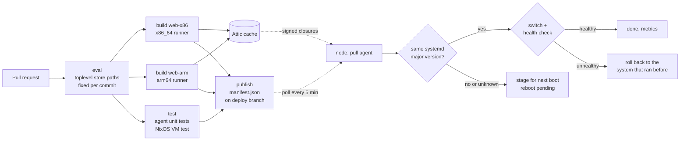

# nixos-fleet-pipeline

Pull-based CI/CD for a NixOS fleet. CI evaluates and builds the complete system of every host, tests it in a VM and pushes it to an [Attic](https://github.com/zhaofengli/attic) binary cache. Each node pulls its own system by hash, switches atomically, checks its health and rolls itself back if anything is wrong.

This is a clean-room reference implementation of the delivery model behind [wpbox](https://github.com/marcothedood/wpbox), the NixOS platform I built at my employer. It runs about 45 production WordPress sites on 10 EC2 Graviton nodes. The production code is private; this repo follows the same design.



## The one idea

A NixOS host is fully described by one store path: its **toplevel**. That path is a hash of everything the machine will run: kernel, systemd units, nginx config, PHP build, every package and every flag. Change one input anywhere and the hash changes.

So the pipeline does not ship instructions for building a server. It ships **the server**:

1. CI evaluates `nixosConfigurations.<host>.config.system.build.toplevel` for every host. The store paths are known before anything is built.
2. CI builds exactly those paths, natively per architecture, and runs the tests.
3. The closures go to the cache, signed.
4. CI publishes a manifest mapping each host to its path.
5. The node fetches that exact path and switches to it.

The hash CI tested is the hash the node runs. There is no step in between where the result can drift.

## Why this beats the classic Ansible + Jenkins pipeline

| | Ansible / Jenkins push | This pipeline |
|---|---|---|
| What CI produces | A playbook and a log of a run | The complete system closure of every host, addressed by hash |
| What production runs | Whatever converging a mutable host produces today: mirror state, package versions, leftovers from older runs | The exact store path CI built and tested |
| Configuration drift | Possible by design, reduced by re-running playbooks | Not representable: read-only `/nix/store`, everything declared |
| Deploy on the host | apt, pip, templating, sometimes compiling, on every host, every time | Download pre-built closures, flip one symlink |
| Rollback | Write and run a reverse playbook, hope it converges | Previous generation is still on disk: one switch, seconds |
| Access to production | CI holds SSH keys to every host | Nodes pull. CI holds no SSH keys, only a cache push token |
| Test fidelity | Containers or molecule approximate the real host | NixOS VM tests boot the same modules that run in production |
| Fleet-wide CVE patch | Run playbooks host by host, watch for divergence | Bump the input, build once, every node pulls the same path |
| Change review | Read the playbook diff, guess the effect | `nix store diff-closures` shows every package that changes, per host, on the PR |

In production a critical PHP vulnerability (CVSS 9.2) was mitigated on every node within 30 minutes of merge, with the upstream PHP fix rolled out the same day.

## How it works

### CI (`.github/workflows/ci.yml`)

| Job | What it does |
|---|---|
| `eval` | `nix flake check --no-build --all-systems`, then evaluates the toplevel path of every host and builds the job matrix from `fleet.nix` |
| `build` | One job per host on a native runner (`ubuntu-24.04` or `ubuntu-24.04-arm`). Builds the toplevel; on PRs writes a closure diff against what production runs now; on `main` pushes the closure to Attic |
| `test` | Agent unit tests plus a NixOS VM test that runs real deploys, a broken deploy, a cleanly stopped critical unit, a deploy that changes the agent's own unit, and the GC lock (KVM enabled on the runner) |
| `publish` | Every push to `main`, green or not. Green: writes the toplevels with `status: "ok"`. Red: writes `status: "failed"`, `enabled: false` and no hosts, so the failure is visible on the deploy branch. Skipped for cancelled runs |
| `rollback` | Manual (`workflow_dispatch`, input `seq`). Republishes the hosts of an earlier green deploy under a new, higher `seq` |

The `deploy` branch is the deployment log: `git log deploy` lists every release and every failed build. The PR closure diff reads the newest manifest with `status: "ok"` from that history, because the tip can be a failed build with no hosts.

`publish` and `rollback` share one concurrency group, and `.github/publish-manifest.sh` refuses to publish a `seq` that is not higher than the one on the branch. A slow, older run can therefore never overwrite a newer manifest.

### The manifest

```json
{
  "seq": 128,
  "rev": "4f1c2e9...",
  "status": "ok",
  "enabled": true,
  "hosts": {
    "web-x86": "/nix/store/4s51mm0r...-nixos-system-web-x86-26.05.20261105.c56a87d",
    "web-arm": "/nix/store/l1gm7aj9...-nixos-system-web-arm-26.05.20261105.c56a87d"
  }
}
```

| Field | Meaning |
|---|---|
| `seq` | The CI run number. It only goes up. A node refuses any manifest older than the last one it applied, so a stale or replayed manifest cannot downgrade it |
| `rev` | The commit the closures were built from |
| `status` | `"ok"` if every build and test passed, `"failed"` otherwise |
| `enabled` | `false` pauses the whole fleet |
| `hosts` | Host name to toplevel store path. Empty for a failed build |

A node applies a manifest only if `status` is `"ok"` and `enabled` is `true`. Anything else is `skipped`, and the node does not record its `seq` as applied, so the same manifest takes effect as soon as it is enabled.

### Operating the fleet

- **Pause.** Commit `"enabled": false` to `manifest.json` on the deploy branch by hand. Every node skips it on its next poll. New pushes to `main` keep the pause: they are published with `enabled: false` until someone sets it back.
- **Resume.** Commit `"enabled": true` on the deploy branch. The `seq` can stay the same.
- **Roll back the fleet.** Run the workflow by hand with the `seq` of the deploy to restore (`git log deploy` shows them). The job republishes that deploy's hosts with the current run number as `seq`, which is higher than anything published before, and with `enabled: true`. The old closures must still be in the cache.

Reverting a commit on the deploy branch is not a rollback: it republishes an older `seq`, and every node refuses it.

### The node (`agent/pull_agent.py`, `modules/pull-agent.nix`)

A systemd timer runs the agent every 5 minutes (with jitter). One run:

1. Fetch the manifest. Skip it unless `status` is `"ok"` and `enabled` is `true`; skip it if its `seq` is older than the last one applied or if this host's path previously failed.
2. If this host's path equals `/run/current-system`, stop. If the node just booted into a system the agent staged earlier, run the health checks once first and record the result (`fleet_deploy_post_boot_healthy`).
3. If the system profile already points at the path but the node has not rebooted into it yet, report `boot_staged` and do nothing else.
4. `nix-store --realise` the path. It comes from the cache; Nix rejects anything not signed by a key in `trusted-public-keys`. Nodes have `max-jobs = 0`, so they never build.
5. Compare the systemd major version of the running system and the target (read from `<toplevel>/systemd`). If they differ, or if either cannot be determined, do not switch live: point the profile at the target, run `switch-to-configuration boot`, report `boot_staged` and `fleet_deploy_reboot_pending 1`. The system is activated by the next reboot.
6. Otherwise remember the running system's path, point the system profile at the target and run `switch-to-configuration switch`.
7. Run the health checks: `systemctl is-system-running --wait`, `systemctl is-active` for every critical unit, and an HTTP check for web nodes.
8. If the switch or a check fails: mark the path bad first, then set the profile back to the remembered path, `systemctl reset-failed`, and switch to it. A non-zero exit from that rollback switch is logged as a warning; the path stays marked bad either way.
9. Write Prometheus metrics for node_exporter's textfile collector.

Design details that matter in production:

- **The agent must survive its own switch.** The unit is `Type = "exec"` with `restartIfChanged = false`. A `oneshot` unit is "activating" for its whole run, and switch-to-configuration starts changed units that are not active. When a deploy changed the agent's own unit, the switch the agent was running waited for a start job on the agent's own unit, with no timeout. An `exec` unit is "active" while it runs, so the switch leaves it alone. `stopIfChanged = false` is not set because it brings the same wait back.
- **A rollback is not a unit failure.** The agent exits 0 after a rollback; the outcome lives in the metrics. A failed agent unit would leave the system "degraded" and fail `is-system-running` and `systemctl --failed` style checks on later deploys. Only agent errors (manifest unreachable, cache failure) exit non-zero.
- **The rollback target is explicit.** The agent rolls back to the path that was running before the deploy, not to "the previous generation number", which can be anything after manual changes.
- **Garbage collection cannot delete the rollback target.** The agent runs under `flock /run/lock/fleet-nix-store.lock`, and the module replaces the `nix-gc` service script with the same `nix-collect-garbage` command under the same lock. Between realising the target and finishing a rollback, the systems involved may have no GC root but the agent itself.
- **Cleanly stopped units are caught.** A unit that stopped with exit 0 is "inactive", not "failed", and slips past `is-system-running`. `services.fleet-pull-agent.criticalUnits` (`[ "nginx" ]` on web nodes) checks those units explicitly.
- **Cold nodes get one retry.** An HTTP check that gets no response at all is retried once with a longer timeout, because a node right after a switch can be slow to answer its first request. An HTTP error status is a real answer and fails immediately.

### Metrics

| Metric | Meaning |
|---|---|
| `fleet_deploy_runs_total{action}` | Runs by outcome: `noop`, `switched`, `rolled_back`, `boot_staged`, `post_boot_check`, `skipped`, `error` |
| `fleet_deploy_manifest_seq` | `seq` of the last manifest seen |
| `fleet_deploy_last_success_timestamp_seconds` | Last successful live switch |
| `fleet_deploy_reboot_pending` | 1 if a system is staged for boot, or the running kernel or initrd differs from the current system's |
| `fleet_deploy_post_boot_healthy` | Health check result after the last reboot into a staged system |
| `fleet_deploy_last_run_timestamp_seconds` | Last agent run |

### What happens when things go wrong

| Failure | Outcome |
|---|---|
| Evaluation, build or VM test fails | A `failed` manifest with no hosts is published. Nodes skip it and keep running the current system |
| Fleet paused (`enabled: false`) | Nodes skip the manifest without recording it as applied |
| Cache unreachable on a node | `realise` fails before anything changes; retried on the next poll |
| A unit fails to start after the switch | Automatic rollback, path marked bad, `rolled_back` metric, alert |
| A critical unit stops cleanly after the switch | Same as above, caught by `systemctl is-active` |
| HTTP check gets no response | One retry with a longer timeout, then rollback |
| HTTP check gets a 5xx | Rollback, no retry |
| The rollback switch itself exits non-zero | Warning logged, the profile and system are back on the previous path, the target stays marked bad |
| The agent dies during a rollback | The target was marked bad before the rollback started, so it is not retried |
| Target has a different or unknown systemd major version | Staged for the next boot, `fleet_deploy_reboot_pending 1`, health checked once after the reboot |
| The deploy changes the agent's own unit | The switch completes; the new unit definition applies from the next run |
| Garbage collection starts during a deploy | It waits for the deploy lock |
| Manifest replaced with an older one | Refused (`seq` check) |
| Manifest points to an unsigned path | Nix refuses to substitute it |

## Repository layout

```
flake.nix                    hosts, packages, checks and the fleet.toplevels contract
fleet.nix                    the fleet: hosts, cache, manifest URL
hosts/<name>/                per-host configuration (EC2 image module + roles)
modules/common.nix           baseline: cache, pull agent, node_exporter, SSH hardening, GC
modules/web.nix              example workload: nginx with /healthz, critical unit and HTTP check
modules/pull-agent.nix       NixOS module for the agent (service, timer, options, GC lock)
agent/                       the agent (Python, standard library only) and its tests
tests/pull-agent.nix         NixOS VM test of switch, rollback, self-update and manifest checks
.github/workflows/ci.yml     the pipeline
.github/publish-manifest.sh  commits a manifest to the deploy branch
```

## Try it

Evaluation only, any machine with Nix:

```sh
nix flake check --no-build --all-systems
nix eval --json .#fleet.toplevels
```

Unit tests and the VM test (Linux with KVM):

```sh
nix build -L .#checks.x86_64-linux.agent .#checks.x86_64-linux.pull-agent-vm
```

`flake.lock` pins nixpkgs, so CI and every node evaluate the same inputs.

## Using it for a real fleet

1. Run an Attic server and create a cache. Put its URL and public key in `fleet.nix`.
2. In the GitHub repo: variables `ATTIC_ENDPOINT` and `ATTIC_CACHE`, secret `ATTIC_TOKEN` (push scope only).
3. Add hosts to `fleet.nix` and a directory under `hosts/`.
4. Bootstrap each machine once (for example with nixos-anywhere). From then on it updates itself.

## Limits and next steps

- The manifest is trusted because only CI can write the `deploy` branch. Signing it (minisign or an SSH key) would remove that dependency on repository permissions.
- All hosts take a new manifest within one polling interval. The production setup staggers hosts in time-based waves. A health-gated canary, where the next wave starts only once the previous one reports healthy metrics, is the natural next step.
- Reboots are not automated. A `boot_staged` node waits for an operator or a maintenance window, and an unhealthy post-boot check is reported, not rolled back: going back would need another reboot.
- A fleet rollback needs the old closures in the cache. Cache retention must cover the window you want to be able to roll back to.
- Secrets are out of scope here; in production they live in sops-nix with AWS KMS and age, decrypted at activation.
- Health checks cover systemd state, critical units and HTTP; application checks plug in through `services.fleet-pull-agent.healthChecks`.

## License

MIT
